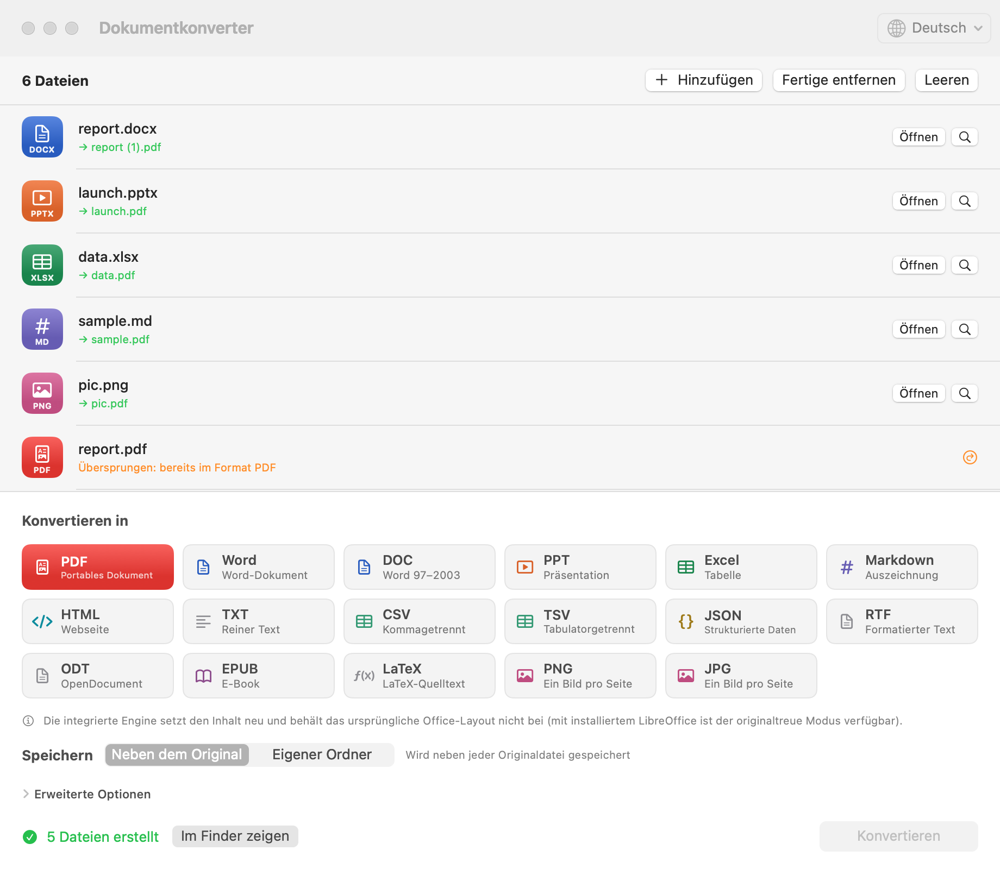

# Dokumentkonverter für macOS

[English](README.md) · [简体中文](README.zh-CN.md) · [繁體中文](README.zh-TW.md) · [日本語](README.ja.md) · [한국어](README.ko.md) · [Français](README.fr.md) · **Deutsch** · [Español](README.es.md)

Konvertiert zwischen PDF, Word, PowerPoint, Excel, Markdown und gängigen Textformaten. Native App in Swift – ohne Office, LibreOffice, Python oder Internetverbindung.

- **App**: Dateien hineinziehen (mehrere auf einmal oder ganze Ordner) → Zielformat wählen → Konvertieren
- **Befehlszeile**: `docconv`, für Stapelverarbeitung und Skripte
- **8 Sprachen der Oberfläche**: 简体中文, 繁體中文, English, 日本語, 한국어, Français, Deutsch, Español. Folgt standardmäßig der Systemsprache; jederzeit über das 🌐-Menü in der Symbolleiste umschaltbar
- Läuft auf Macs mit Apple Silicon und Intel, ab macOS 13



## Unterstützte Formate

| Format | Lesen | Schreiben | Hinweise |
| --- | :-: | :-: | --- |
| PDF | ✓ | ✓ | Lesen: übernimmt Text, Überschriften, Listen, einfache Tabellen und Code; gescannte Seiten laufen durch die Texterkennung von macOS (OCR); alternativ „Ganze Seiten als Bilder“. Schreiben: automatischer Seitenumbruch, Seitenzahlen, Tabellen, Bilder und Links |
| Word .docx | ✓ | ✓ | Überschriftenformate, mehrstufige Listen, Tabellen, Bilder, Links, fett/kursiv/durchgestrichen, Seitenumbrüche |
| Word 97 .doc | ✓ | ✓ | Über das Textsystem von macOS |
| PowerPoint .pptx | ✓ | ✓ | Lesen: Titel jeder Folie, Textebenen, Tabellen, Bilder, optional Notizen. Schreiben: Folien werden an Überschriften geteilt, zu langer Inhalt wird auf neuen Folien fortgesetzt |
| Excel .xlsx | ✓ | ✓ | Mehrere Blätter, Datumswerte, Prozente, Zahlen; beim Export wird die Kopfzeile fixiert und gefiltert |
| Markdown | ✓ | ✓ | Gängige CommonMark-Syntax plus GFM-Tabellen, Durchstreichen und Aufgabenlisten; Bilder in einem `_assets`-Ordner (oder eingebettet) |
| HTML | ✓ | ✓ | Als einzelne formatierte Seite mit eingebetteten Bildern |
| TXT | ✓ | ✓ | Erkennt UTF-8 / UTF-16 / GBK / GB18030 / Big5 / Shift-JIS |
| CSV / TSV | ✓ | ✓ | Erkennt das Trennzeichen; mit BOM geschrieben, damit Excel nicht-lateinische Zeichen richtig anzeigt; mehrere Tabellen ergeben mehrere Dateien |
| JSON | ✓ | ✓ | Tabellen ↔ Arrays von Objekten; andere Dokumente werden zu strukturiertem JSON |
| RTF / ODT | ✓ | ✓ | |
| EPUB | ✓ | ✓ | In Kapitel geteilt, mit Inhaltsverzeichnis |
| LaTeX | | ✓ | ctex-Vorlage, mit xelatex übersetzen |
| PNG / JPG | ✓ | ✓ | PDFs werden Seite für Seite gerastert; andere Dokumente werden zuerst gesetzt; Bilder lassen sich in PDF, Word oder PowerPoint umwandeln |

## Funktionsweise

Jedes Format wird zuerst in eine gemeinsame **Zwischenstruktur** gelesen (Überschriften, Absätze, Listen, Tabellen, Code, Zitate, Bilder, Seitenumbrüche) und daraus wieder geschrieben. N Eingabe- und M Ausgabeformate brauchen so nur N + M Lese- und Schreibmodule, und jedes Paar lässt sich konvertieren.

### Zur Originaltreue

- **PDF → Word / PowerPoint / Excel** übernimmt Text und Struktur, baut aber das Seitenlayout nicht nach. Mehrspaltige Layouts, komplexe Tabellen und frei platzierte Grafiken lassen sich nicht vollständig wiedergeben. Um das Aussehen zu erhalten, wähle in den erweiterten Optionen „Ganze Seiten als Bilder“ (jede Seite wird als Bild eingefügt; der Text ist nicht bearbeitbar).
- **Office → PDF** wird von der integrierten Engine neu gesetzt – ohne die ursprünglichen Schriften, das Layout oder Animationen. Ist [LibreOffice](https://www.libreoffice.org) installiert, lässt sich in den erweiterten Optionen der originaltreue Modus einschalten, der die Konvertierung LibreOffice überlässt.
- **Beim Export nach Excel / CSV** bleiben nur die Tabellen erhalten; Dokumente ohne Tabellen werden zeilenweise geschrieben.
- Beschriftungen, die der Konverter in Dokumente einfügt (etwa „Folie 3“, „Notizen“, „(Forts.)“ oder „[Bild]“), verwenden die aktuelle Sprache der Oberfläche.
- Erzeugte PDFs verwenden die Schrift Hiragino Sans GB. Mit PingFang werden manche chinesischen Schriftzeichen beim Kopieren zu Kangxi-Radikalen (wie „⼀“ oder „⻓“); PDFs aus anderer Software mit solchen Zeichen werden beim Lesen automatisch korrigiert.

## Verwendung

### App

Öffne `DocConverter.app`.

Die App ist nur lokal signiert und nicht von Apple notariell beglaubigt. Wurde sie heruntergeladen, meldet macOS beim ersten Öffnen eventuell, dass der Entwickler nicht überprüft werden kann. Dann entweder:

- **Systemeinstellungen → Datenschutz & Sicherheit** öffnen und unten auf **Dennoch öffnen** klicken, oder
- im Terminal `xattr -dr com.apple.quarantine DocConverter.app` ausführen

Beim Konvertieren von Dateien aus Schreibtisch, Dokumente oder Downloads fragt macOS, ob die App auf diesen Ordner zugreifen darf. Wähle **Erlauben**.

- Dateien oder Ordner ins Fenster ziehen oder ⌘O drücken
- Zielformat wählen (Formate, in die die aktuellen Dateien nicht konvertiert werden können, sind ausgegraut)
- Speicherort wählen: neben dem Original oder ein eigener Ordner. Vorhandene Dateien werden nie überschrieben; stattdessen wird (1), (2) … angehängt
- Mit ⌘↩ konvertieren; danach die Ergebnisse öffnen oder im Finder zeigen
- Im Finder funktioniert auch **Öffnen mit → Dokumentkonverter**
- Die Sprache der Oberfläche über das 🌐-Menü in der Symbolleiste wechseln. Systemmenüs (Bearbeiten, Fenster …) wechseln nach dem erneuten Öffnen der App. Die App-spezifische Sprache in Systemeinstellungen → Allgemein → Sprache & Region funktioniert ebenfalls

### Befehlszeile

```bash
# Das Befehlszeilenwerkzeug liegt in der App; es lässt sich in den PATH verlinken
ln -s "$PWD/DocConverter.app/Contents/MacOS/docconv" /usr/local/bin/docconv

docconv -t docx bericht.pdf                # PDF → Word
docconv -t pdf -o ~/Desktop/out *.md       # Markdown → PDF im Stapel
docconv -t pptx --split 1 vortrag.md       # eine Folie pro Überschrift der Ebene 1
docconv -t md --notes keynote.pptx         # mit Notizen
docconv -t png --dpi 300 vertrag.pdf       # jede PDF-Seite als PNG
docconv --lang de --formats                # Meldungen auf Deutsch
docconv --help                             # alle Optionen
```

Das Werkzeug bestimmt seine Sprache über `--lang`, dann `LC_ALL` / `LC_MESSAGES` / `LANG`, dann die Systemsprache.

## Aus dem Quelltext bauen

Nötig sind nur die Xcode Command Line Tools (`xcode-select --install`), nicht das vollständige Xcode.

```bash
scripts/build_app.sh            # universelles dist/DocConverter.app und dist/DocConverter.zip
NATIVE=1 scripts/build_app.sh   # nur die Architektur dieses Macs (schneller)
scripts/selftest.sh             # Schnelltest: Beispiel in jedes Format und zurück, ZIP/XML-Prüfung
scripts/fulltest.sh             # Volltest: Konvertierungsmatrix, jede Option, fehlerhafte Eingaben, Leistung
swift run docconv --help        # Befehlszeilenwerkzeug direkt starten
```

`PYTHON=/pfad/zu/python scripts/fulltest.sh` öffnet zusätzlich jede Word-, Excel- und PowerPoint-Ausgabe mit python-docx, openpyxl und python-pptx, sofern diese in jenem Python installiert sind.

## Projektaufbau

```
Sources/
  DocCore/           plattformunabhängiger Kern: Zwischenstruktur, ZIP, XML, Kodierungserkennung,
                     Lesen und Schreiben von md/html/txt/csv/json/docx/pptx/xlsx/epub/tex
    Localization/    Texte der Oberfläche, eine Datei pro Sprache
  DocCoreMac/        macOS-spezifisch: PDF (PDFKit + TextKit), RTF/DOC/ODT, Bildausgabe,
                     Vision-OCR, LibreOffice-Anbindung
  docconv/           Befehlszeilenwerkzeug
  DocConverterApp/   SwiftUI-App
scripts/             Paketierung, Symbol, Tests
Tests/fixtures/      Testdokumente
```

### Eine Sprache hinzufügen

1. In `Sources/DocCore/Localization/Localization.swift` einen Fall zu `AppLanguage` hinzufügen.
2. `Strings+en.swift` als `Strings+xx.swift` kopieren und übersetzen. Jede Meldung ist ein Pflichtmitglied des Protokolls `LocalizedStrings`, der Compiler listet also alles Fehlende auf.
3. Den Sprachcode in `scripts/build_app.sh` zu `LANGS` hinzufügen.

Die chinesischen und englischen Texte wurden für dieses Projekt geschrieben; die übrigen Übersetzungen sind noch nicht von Muttersprachlern geprüft, Korrekturen sind willkommen.

### Windows / Linux

`DocCore` hängt nur von Foundation und zlib ab und lässt sich mit der Swift-Toolchain unter Windows und Linux bauen (Linux braucht ein System-Library-Target für zlib). Ersetzt werden muss nur die Schicht `DocCoreMac`: PDF lesen und schreiben, RTF/DOC/ODT, OCR und Bildkodierung. Die Oberfläche der App müsste neu geschrieben oder auf ein plattformübergreifendes Framework portiert werden.
