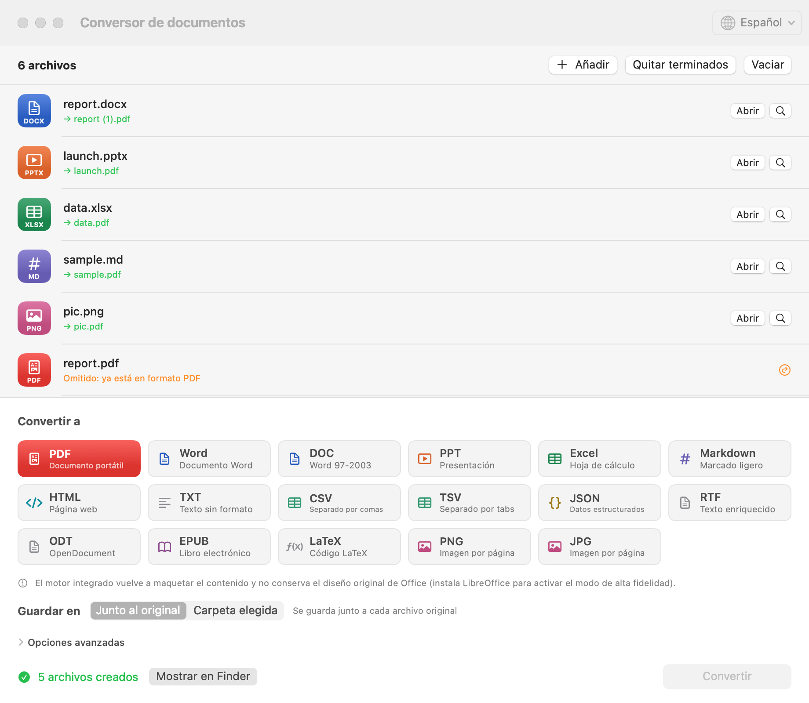

# Conversor de documentos para macOS

[English](README.md) · [简体中文](README.zh-CN.md) · [繁體中文](README.zh-TW.md) · [日本語](README.ja.md) · [한국어](README.ko.md) · [Français](README.fr.md) · [Deutsch](README.de.md) · **Español**

Convierte entre PDF, Word, PowerPoint, Excel, Markdown y los formatos de texto habituales. App nativa escrita en Swift, sin depender de Office, LibreOffice, Python ni de internet.

- **App**: arrastra archivos (varios a la vez o carpetas enteras) → elige el formato de destino → Convertir
- **Línea de comandos**: `docconv`, para lotes y scripts
- **8 idiomas de interfaz**: 简体中文, 繁體中文, English, 日本語, 한국어, Français, Deutsch, Español. Sigue el idioma del sistema por omisión; cámbialo cuando quieras desde el menú 🌐 de la barra de herramientas
- Funciona en Mac con Apple silicon e Intel, macOS 13 o posterior



## Formatos compatibles

| Formato | Lectura | Escritura | Notas |
| --- | :-: | :-: | --- |
| PDF | ✓ | ✓ | Lectura: extrae texto, títulos, listas, tablas sencillas y código; las páginas escaneadas pasan por el reconocimiento de texto de macOS (OCR); o elige «Páginas como imágenes». Escritura: paginación automática, números de página, tablas, imágenes y enlaces |
| Word .docx | ✓ | ✓ | Estilos de título, listas de varios niveles, tablas, imágenes, enlaces, negrita/cursiva/tachado, saltos de página |
| Word 97 .doc | ✓ | ✓ | A través del sistema de texto de macOS |
| PowerPoint .pptx | ✓ | ✓ | Lectura: título de cada diapositiva, niveles del texto, tablas, imágenes y, opcionalmente, notas del orador. Escritura: diapositivas divididas en los títulos; el contenido largo continúa en diapositivas nuevas |
| Excel .xlsx | ✓ | ✓ | Varias hojas, fechas, porcentajes, números; al exportar se fija la fila de encabezado y se activa el filtro |
| Markdown | ✓ | ✓ | Sintaxis habitual de CommonMark más tablas GFM, tachado y listas de tareas; imágenes guardadas en una carpeta `_assets` (o incrustadas) |
| HTML | ✓ | ✓ | Se escribe como una sola página con estilos e imágenes incrustadas |
| TXT | ✓ | ✓ | Detecta UTF-8 / UTF-16 / GBK / GB18030 / Big5 / Shift-JIS |
| CSV / TSV | ✓ | ✓ | Detecta el separador; se escribe con BOM para que Excel muestre bien los caracteres no latinos; varias tablas generan varios archivos |
| JSON | ✓ | ✓ | Tablas ↔ arrays de objetos; los demás documentos se convierten en JSON estructurado |
| RTF / ODT | ✓ | ✓ | |
| EPUB | ✓ | ✓ | Dividido en capítulos, con índice |
| LaTeX | | ✓ | Plantilla ctex, se compila con xelatex |
| PNG / JPG | ✓ | ✓ | Los PDF se rasterizan página a página; los demás documentos se maquetan primero; las imágenes pueden pasar a PDF, Word o PowerPoint |

## Cómo funciona

Cada formato se lee primero en una **estructura intermedia** común (títulos, párrafos, listas, tablas, código, citas, imágenes, saltos de página) y después se escribe a partir de ella. Así, N formatos de entrada y M de salida solo necesitan N + M lectores y escritores, y se puede convertir cualquier pareja.

### Sobre la fidelidad

- **PDF → Word / PowerPoint / Excel** extrae el texto y la estructura; no reconstruye el diseño de la página. Los diseños en columnas, las tablas complejas y los gráficos flotantes no se reproducen por completo. Para conservar el aspecto, elige «Páginas como imágenes» en Opciones avanzadas (cada página se coloca como imagen; el texto no es editable).
- **Office → PDF** lo vuelve a maquetar el motor integrado, sin las fuentes, el diseño ni las animaciones originales. Si tienes [LibreOffice](https://www.libreoffice.org) instalado, puedes activar el modo de alta fidelidad en Opciones avanzadas para que la conversión la haga LibreOffice.
- **Al exportar a Excel / CSV** solo se conservan las tablas; los documentos sin tablas se escriben línea por línea.
- Las etiquetas que el conversor añade a los documentos (como «Diapositiva 3», «Notas del orador», «(cont.)» o «[Imagen]») usan el idioma actual de la interfaz.
- Los PDF generados usan la fuente Hiragino Sans GB. Con PingFang, algunos caracteres chinos se convierten en radicales Kangxi (como «⼀» o «⻓») al copiar el texto; los PDF de otros programas que contienen esos caracteres se corrigen automáticamente al leerlos.

## Uso

### App

Abre `DocConverter.app`.

La app solo está firmada localmente y no está notarizada por Apple. Si la descargaste, es posible que macOS indique la primera vez que no se puede verificar el desarrollador. Puedes:

- abrir **Ajustes del Sistema → Privacidad y seguridad** y hacer clic en **Abrir igualmente** al final de la página, o
- ejecutar `xattr -dr com.apple.quarantine DocConverter.app` en Terminal

Cuando conviertas archivos del Escritorio, Documentos o Descargas, macOS preguntará si la app puede acceder a esa carpeta. Elige **Permitir**.

- Arrastra archivos o carpetas a la ventana, o pulsa ⌘O
- Elige un formato de destino (los formatos a los que no se pueden convertir los archivos actuales aparecen atenuados)
- Elige dónde guardar: junto al original o en una carpeta a tu elección. Nunca se sobrescriben archivos existentes; se añade un sufijo (1), (2)…
- Pulsa ⌘↩ para convertir; al terminar puedes abrir los resultados o mostrarlos en Finder
- También puedes usar **Abrir con → Conversor de documentos** sobre archivos en Finder
- Cambia el idioma de la interfaz desde el menú 🌐 de la barra de herramientas. Los menús del sistema (Edición, Ventana…) cambian al volver a abrir la app. También funciona el idioma por app de Ajustes del Sistema → General → Idioma y región

### Línea de comandos

```bash
# La herramienta de línea de comandos viene dentro de la app; puedes enlazarla en tu PATH
ln -s "$PWD/DocConverter.app/Contents/MacOS/docconv" /usr/local/bin/docconv

docconv -t docx informe.pdf                # PDF → Word
docconv -t pdf -o ~/Desktop/out *.md       # Markdown → PDF por lotes
docconv -t pptx --split 1 charla.md        # una diapositiva por título de nivel 1
docconv -t md --notes keynote.pptx         # con las notas del orador
docconv -t png --dpi 300 contrato.pdf      # cada página del PDF como PNG
docconv --lang es --formats                # mensajes en español
docconv --help                             # todas las opciones
```

La herramienta elige el idioma según `--lang`, después `LC_ALL` / `LC_MESSAGES` / `LANG` y, por último, el idioma del sistema.

## Compilar desde el código fuente

Solo hacen falta las herramientas de línea de comandos de Xcode (`xcode-select --install`), no Xcode completo.

```bash
scripts/build_app.sh            # dist/DocConverter.app universal y dist/DocConverter.zip
NATIVE=1 scripts/build_app.sh   # solo la arquitectura de este Mac (más rápido)
scripts/selftest.sh             # prueba rápida: ejemplo a todos los formatos y vuelta, comprobación ZIP/XML
scripts/fulltest.sh             # prueba completa: matriz de conversión, cada opción, entradas defectuosas, rendimiento
swift run docconv --help        # ejecutar directamente la herramienta de línea de comandos
```

`PYTHON=/ruta/a/python scripts/fulltest.sh` abre además cada salida de Word, Excel y PowerPoint con python-docx, openpyxl y python-pptx, si ese Python los tiene instalados.

## Estructura del proyecto

```
Sources/
  DocCore/           núcleo independiente de la plataforma: estructura intermedia, ZIP, XML, detección de codificación,
                     lectura y escritura de md/html/txt/csv/json/docx/pptx/xlsx/epub/tex
    Localization/    textos de la interfaz, un archivo por idioma
  DocCoreMac/        específico de macOS: PDF (PDFKit + TextKit), RTF/DOC/ODT, salida de imágenes,
                     OCR de Vision, puente con LibreOffice
  docconv/           herramienta de línea de comandos
  DocConverterApp/   app SwiftUI
scripts/             empaquetado, icono, pruebas
Tests/fixtures/      documentos de prueba
```

### Añadir un idioma

1. Añade un caso a `AppLanguage` en `Sources/DocCore/Localization/Localization.swift`.
2. Copia `Strings+en.swift` como `Strings+xx.swift` y tradúcelo. Cada mensaje es un miembro obligatorio del protocolo `LocalizedStrings`, así que el compilador indica todo lo que falte.
3. Añade el código de idioma a `LANGS` en `scripts/build_app.sh`.

Los textos en chino e inglés se escribieron para este proyecto; las demás traducciones aún no las han revisado hablantes nativos, y las correcciones son bienvenidas.

### Windows / Linux

`DocCore` solo depende de Foundation y zlib, y se compila con la cadena de herramientas de Swift en Windows y Linux (en Linux hace falta un target de system library para zlib). Solo hay que sustituir la capa `DocCoreMac`: lectura y escritura de PDF, RTF/DOC/ODT, OCR y codificación de imágenes. La interfaz de la app habría que reescribirla o llevarla a un framework multiplataforma.
