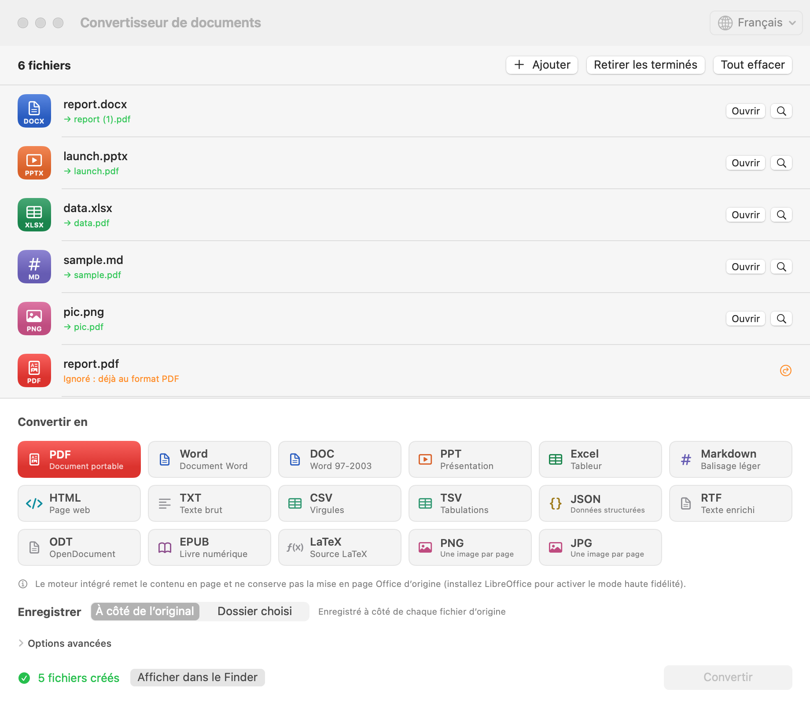

# Convertisseur de documents pour macOS

[English](README.md) · [简体中文](README.zh-CN.md) · [繁體中文](README.zh-TW.md) · [日本語](README.ja.md) · [한국어](README.ko.md) · **Français** · [Deutsch](README.de.md) · [Español](README.es.md)

Convertit entre PDF, Word, PowerPoint, Excel, Markdown et les formats texte courants. Application native écrite en Swift, sans dépendance à Office, LibreOffice, Python ni à Internet.

- **App** : déposez des fichiers (plusieurs à la fois, ou des dossiers entiers) → choisissez le format cible → Convertir
- **Ligne de commande** : `docconv`, pour les traitements par lot et les scripts
- **8 langues d’interface** : 简体中文, 繁體中文, English, 日本語, 한국어, Français, Deutsch, Español. Suit la langue du système par défaut ; changez-la à tout moment avec le menu 🌐 de la barre d’outils
- Fonctionne sur les Mac Apple silicon et Intel, macOS 13 ou ultérieur



## Formats pris en charge

| Format | Lecture | Écriture | Remarques |
| --- | :-: | :-: | --- |
| PDF | ✓ | ✓ | Lecture : extrait le texte, les titres, les listes, les tableaux simples et le code ; les pages numérisées passent par la reconnaissance de texte de macOS (OCR) ; ou choisissez « Pages en images ». Écriture : pagination automatique, numéros de page, tableaux, images et liens |
| Word .docx | ✓ | ✓ | Styles de titre, listes à plusieurs niveaux, tableaux, images, liens, gras/italique/barré, sauts de page |
| Word 97 .doc | ✓ | ✓ | Via le système de texte de macOS |
| PowerPoint .pptx | ✓ | ✓ | Lecture : titre de chaque diapositive, niveaux du texte, tableaux, images, notes du présentateur en option. Écriture : diapositives découpées aux titres, le contenu trop long continue sur de nouvelles diapositives |
| Excel .xlsx | ✓ | ✓ | Plusieurs feuilles, dates, pourcentages, nombres ; ligne d’en-tête figée et filtrée à l’export |
| Markdown | ✓ | ✓ | Syntaxe CommonMark courante plus tableaux GFM, texte barré et listes de tâches ; images enregistrées dans un dossier `_assets` (ou intégrées) |
| HTML | ✓ | ✓ | Écrit comme une page unique mise en forme, images intégrées |
| TXT | ✓ | ✓ | Détecte UTF-8 / UTF-16 / GBK / GB18030 / Big5 / Shift-JIS |
| CSV / TSV | ✓ | ✓ | Détecte le séparateur ; écrit avec un BOM pour qu’Excel affiche correctement les caractères non latins ; plusieurs tableaux donnent plusieurs fichiers |
| JSON | ✓ | ✓ | Tableaux ↔ tableaux d’objets ; les autres documents deviennent du JSON structuré |
| RTF / ODT | ✓ | ✓ | |
| EPUB | ✓ | ✓ | Découpé en chapitres, avec table des matières |
| LaTeX | | ✓ | Modèle ctex, à compiler avec xelatex |
| PNG / JPG | ✓ | ✓ | Les PDF sont rastérisés page par page ; les autres documents sont d’abord mis en page ; les images peuvent devenir PDF, Word ou PowerPoint |

## Fonctionnement

Chaque format est d’abord lu dans une même **structure intermédiaire** (titres, paragraphes, listes, tableaux, code, citations, images, sauts de page), puis réécrit à partir d’elle. N formats d’entrée et M formats de sortie ne demandent donc que N + M lecteurs et écrivains, et n’importe quelle paire peut être convertie.

### Fidélité

- **PDF → Word / PowerPoint / Excel** extrait le texte et la structure ; la mise en page n’est pas reconstruite. Les mises en page en colonnes, les tableaux complexes et les objets flottants ne peuvent pas être reproduits entièrement. Pour garder l’apparence, choisissez « Pages en images » dans les options avancées (chaque page est placée comme une image ; le texte n’est pas modifiable).
- **Office → PDF** est remis en page par le moteur intégré, sans les polices, la mise en page ni les animations d’origine. Si [LibreOffice](https://www.libreoffice.org) est installé, vous pouvez activer le mode haute fidélité dans les options avancées et confier la conversion à LibreOffice.
- **L’export vers Excel / CSV** ne conserve que les tableaux ; les documents sans tableau sont écrits ligne par ligne.
- Les libellés ajoutés aux documents par le convertisseur (comme « Diapositive 3 », « Notes du présentateur », « (suite) » ou « [Image] ») utilisent la langue actuelle de l’interface.
- Les PDF générés utilisent la police Hiragino Sans GB. Avec PingFang, certains caractères chinois deviennent des radicaux Kangxi (comme « ⼀ » ou « ⻓ ») lorsqu’on copie le texte ; les PDF d’autres logiciels contenant ces caractères sont corrigés automatiquement à la lecture.

## Utilisation

### App

Ouvrez `DocConverter.app`.

L’app est seulement signée localement et n’est pas notariée par Apple. Si vous l’avez téléchargée, macOS peut indiquer à la première ouverture que le développeur ne peut pas être vérifié. Au choix :

- ouvrez **Réglages Système → Confidentialité et sécurité** et cliquez sur **Ouvrir quand même** en bas de la page, ou
- exécutez `xattr -dr com.apple.quarantine DocConverter.app` dans le Terminal

Quand vous convertissez des fichiers du Bureau, de Documents ou de Téléchargements, macOS demande si l’app peut accéder à ce dossier. Choisissez **Autoriser**.

- Déposez des fichiers ou des dossiers sur la fenêtre, ou appuyez sur ⌘O
- Choisissez un format cible (les formats impossibles pour les fichiers actuels sont grisés)
- Choisissez où enregistrer : à côté de l’original, ou dans un dossier de votre choix. Les fichiers existants ne sont jamais écrasés ; un suffixe (1), (2)… est ajouté
- Appuyez sur ⌘↩ pour convertir ; ouvrez ensuite les résultats ou affichez-les dans le Finder
- Vous pouvez aussi utiliser **Ouvrir avec → Convertisseur de documents** sur des fichiers dans le Finder
- Changez la langue de l’interface avec le menu 🌐 de la barre d’outils. Les menus système (Édition, Fenêtre…) changent après la réouverture de l’app. Le réglage de langue par app dans Réglages Système → Général → Langue et région fonctionne aussi

### Ligne de commande

```bash
# L’outil en ligne de commande est fourni dans l’app ; vous pouvez le lier dans votre PATH
ln -s "$PWD/DocConverter.app/Contents/MacOS/docconv" /usr/local/bin/docconv

docconv -t docx rapport.pdf                # PDF → Word
docconv -t pdf -o ~/Desktop/out *.md       # Markdown → PDF par lot
docconv -t pptx --split 1 expose.md        # une diapositive par titre de niveau 1
docconv -t md --notes keynote.pptx         # avec les notes du présentateur
docconv -t png --dpi 300 contrat.pdf       # chaque page du PDF en PNG
docconv --lang fr --formats                # messages en français
docconv --help                             # toutes les options
```

L’outil choisit sa langue d’après `--lang`, puis `LC_ALL` / `LC_MESSAGES` / `LANG`, puis la langue du système.

## Compiler depuis les sources

Seuls les outils en ligne de commande de Xcode sont nécessaires (`xcode-select --install`), pas Xcode complet.

```bash
scripts/build_app.sh            # dist/DocConverter.app universel et dist/DocConverter.zip
NATIVE=1 scripts/build_app.sh   # architecture de ce Mac seulement (plus rapide)
scripts/selftest.sh             # test rapide : exemple vers tous les formats et retour, contrôles ZIP/XML
scripts/fulltest.sh             # test complet : matrice de conversion, chaque option, entrées défectueuses, performances
swift run docconv --help        # lancer directement l’outil en ligne de commande
```

`PYTHON=/chemin/vers/python scripts/fulltest.sh` ouvre en plus chaque sortie Word, Excel et PowerPoint avec python-docx, openpyxl et python-pptx, si ce Python les a installés.

## Organisation du projet

```
Sources/
  DocCore/           cœur indépendant de la plateforme : structure intermédiaire, ZIP, XML, détection d’encodage,
                     lecture et écriture md/html/txt/csv/json/docx/pptx/xlsx/epub/tex
    Localization/    textes de l’interface, un fichier par langue
  DocCoreMac/        spécifique à macOS : PDF (PDFKit + TextKit), RTF/DOC/ODT, sortie d’images,
                     OCR Vision, passerelle LibreOffice
  docconv/           outil en ligne de commande
  DocConverterApp/   app SwiftUI
scripts/             paquetage, icône, tests
Tests/fixtures/      documents de test
```

### Ajouter une langue

1. Ajoutez un cas à `AppLanguage` dans `Sources/DocCore/Localization/Localization.swift`.
2. Copiez `Strings+en.swift` en `Strings+xx.swift` et traduisez-le. Chaque message est un membre obligatoire du protocole `LocalizedStrings` : le compilateur liste tout ce qui manque.
3. Ajoutez le code de langue à `LANGS` dans `scripts/build_app.sh`.

Les textes chinois et anglais ont été écrits pour ce projet ; les autres traductions n’ont pas encore été relues par des locuteurs natifs, et les corrections sont les bienvenues.

### Windows / Linux

`DocCore` ne dépend que de Foundation et de zlib et se compile avec la chaîne d’outils Swift sous Windows et Linux (Linux nécessite une cible system library pour zlib). Seule la couche `DocCoreMac` est à remplacer : lecture et écriture PDF, RTF/DOC/ODT, OCR et encodage d’images. L’interface de l’app serait à réécrire ou à porter vers un framework multiplateforme.
