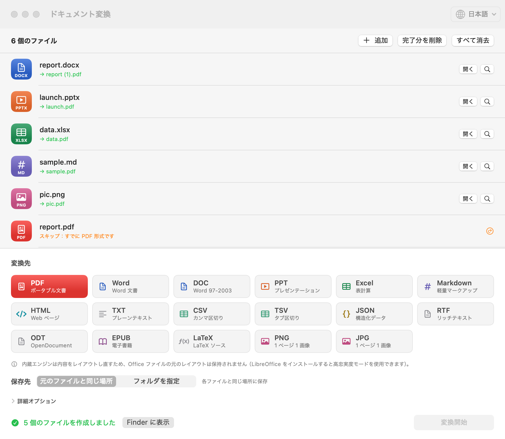

# ドキュメント変換 for macOS

[English](README.md) · [简体中文](README.zh-CN.md) · [繁體中文](README.zh-TW.md) · **日本語** · [한국어](README.ko.md) · [Français](README.fr.md) · [Deutsch](README.de.md) · [Español](README.es.md)

PDF、Word、PowerPoint、Excel、Markdown、一般的なテキスト形式を相互に変換します。Swift によるネイティブアプリで、Office、LibreOffice、Python、インターネット接続は不要です。

- **アプリ**：ファイルをドロップ（複数可、フォルダごとでも可）→ 変換先の形式を選ぶ → 変換開始
- **コマンドライン**：`docconv`。一括処理やスクリプトに
- **8 つの表示言語**：简体中文、繁體中文、English、日本語、한국어、Français、Deutsch、Español。初期設定ではシステムの言語に従い、ツールバーの 🌐 メニューからいつでも切り替えられます
- Apple シリコンと Intel の Mac に対応、macOS 13 以降



## 対応形式

| 形式 | 読み込み | 書き出し | 説明 |
| --- | :-: | :-: | --- |
| PDF | ✓ | ✓ | 読み込み：テキスト、見出し、リスト、簡単な表、コードを抽出。スキャンページはシステムの文字認識（OCR）で処理。「ページ全体を画像に」も選べます。書き出し：自動改ページ、ページ番号、表、画像、リンク |
| Word .docx | ✓ | ✓ | 見出しスタイル、多階層リスト、表、画像、リンク、太字／斜体／取り消し線、改ページ |
| Word 97 .doc | ✓ | ✓ | macOS のテキストシステム経由 |
| PowerPoint .pptx | ✓ | ✓ | 読み込み：各スライドのタイトル、本文の階層、表、画像、発表者ノート（任意）。書き出し：見出しごとにスライドを分割し、はみ出した内容は次のスライドに続けます |
| Excel .xlsx | ✓ | ✓ | 複数シート、日付、パーセント、数値。書き出し時は見出し行を固定し、フィルタを設定 |
| Markdown | ✓ | ✓ | CommonMark の主要な記法 + GFM の表、取り消し線、タスクリスト。画像は `_assets` フォルダに保存（埋め込みも可） |
| HTML | ✓ | ✓ | スタイル付きの単一ページとして書き出し、画像は埋め込み |
| TXT | ✓ | ✓ | UTF-8 / UTF-16 / GBK / GB18030 / Big5 / Shift-JIS を自動判別 |
| CSV / TSV | ✓ | ✓ | 区切り文字を自動判別。BOM 付きで書き出すので Excel でも文字化けしません。表が複数あれば複数のファイルに |
| JSON | ✓ | ✓ | 表 ↔ オブジェクトの配列。その他の文書は構造化 JSON に |
| RTF / ODT | ✓ | ✓ | |
| EPUB | ✓ | ✓ | 章ごとに分割し、目次付き |
| LaTeX | | ✓ | ctex テンプレート。xelatex でコンパイル |
| PNG / JPG | ✓ | ✓ | PDF はページごとにラスタライズ。その他の文書はレイアウトしてから画像化。画像は PDF、Word、PowerPoint に変換可能 |

## しくみ

すべての形式はまず共通の**中間構造**（見出し、段落、リスト、表、コード、引用、画像、改ページ）に読み込まれ、そこから変換先の形式に書き出されます。そのため N 種類の入力と M 種類の出力に必要なのは N+M 個の読み書きモジュールだけで、どの組み合わせでも変換できます。

### 再現性について

- **PDF → Word／PowerPoint／Excel** は文字と構造を抽出するもので、ページのレイアウトは再現しません。段組み、複雑な表、浮動する図形は完全には再現できません。見た目を保ちたい場合は「詳細オプション」で「ページ全体を画像に」を選んでください（各ページを画像として配置し、文字は編集できません）。
- **Office → PDF** は内蔵エンジンが内容をレイアウトし直すため、元のフォント、レイアウト、アニメーションは保持されません。[LibreOffice](https://www.libreoffice.org) がインストールされていれば、詳細オプションで高忠実度モードを有効にして LibreOffice に変換させることができます。
- **Excel／CSV への書き出し**では表だけが残ります。表のない文書は文字を 1 行ずつ書き込みます。
- 変換時に文書へ追加されるラベル（「スライド 3」「発表者ノート」「（続き）」「[画像]」など）は現在の表示言語になります。
- 生成する PDF には冬青黒体（Hiragino Sans GB）を使います。苹方（PingFang）では、テキストをコピーしたときに一部の漢字が「⼀」「⻓」のような康熙部首文字になるためです。ほかのソフトが作成した PDF にこうした文字が含まれていても、読み込み時に自動で直します。

## 使い方

### アプリ

`DocConverter.app` を開きます。

このアプリはローカルで署名しただけで、Apple の公証は受けていません。ダウンロードした場合、初めて開くときに「開発元を検証できません」と表示されることがあります。次のどちらかで開けます。

- 「システム設定 → プライバシーとセキュリティ」を開き、下の方にある「このまま開く」をクリック
- またはターミナルで `xattr -dr com.apple.quarantine DocConverter.app` を実行

デスクトップ、書類、ダウンロードフォルダのファイルを変換するときは、そのフォルダへのアクセスを許可するか macOS が確認します。「許可」を選んでください。

- ファイルやフォルダをウインドウにドロップするか、⌘O で追加
- 変換先の形式を選択（現在のファイルを変換できない形式はグレー表示）
- 保存先は「元のファイルと同じ場所」か「フォルダを指定」。同名のファイルは上書きせず、(1)、(2) を付けて保存します
- ⌘↩ で変換開始。完了後はそのまま開いたり Finder に表示したりできます
- Finder でファイルを「このアプリケーションで開く → ドキュメント変換」で開くこともできます
- 表示言語はツールバーの 🌐 メニューで切り替えます。システムが提供するメニュー（編集、ウインドウなど）はアプリを開き直すと切り替わります。「システム設定 → 一般 → 言語と地域 → アプリケーション」でアプリごとに設定することもできます

### コマンドライン

```bash
# コマンドラインツールはアプリに同梱されています。PATH にリンクを作成できます
ln -s "$PWD/DocConverter.app/Contents/MacOS/docconv" /usr/local/bin/docconv

docconv -t docx 報告書.pdf                  # PDF → Word
docconv -t pdf -o ~/Desktop/out *.md       # Markdown → PDF を一括で
docconv -t pptx --split 1 原稿.md          # 見出し 1 ごとにスライドを分割
docconv -t md --notes 発表会.pptx          # 発表者ノートも含めて書き出し
docconv -t png --dpi 300 契約書.pdf         # PDF の各ページを PNG に
docconv --lang ja --formats                # メッセージを日本語で表示
docconv --help                             # すべてのオプション
```

コマンドラインの言語は `--lang`、`LC_ALL` / `LC_MESSAGES` / `LANG`、システムの言語の順に決まります。

## ソースからのビルド

必要なのは Xcode コマンドラインツール（`xcode-select --install`）だけで、Xcode 本体は不要です。

```bash
scripts/build_app.sh            # ユニバーサル版の dist/DocConverter.app と dist/DocConverter.zip
NATIVE=1 scripts/build_app.sh   # この Mac のアーキテクチャのみ（高速）
scripts/selftest.sh             # 簡易テスト：サンプルを全形式に変換して戻し、ZIP/XML を検査
scripts/fulltest.sh             # 完全なテスト：変換マトリクス、全オプション、異常な入力、性能
swift run docconv --help        # コマンドラインツールを直接実行
```

`PYTHON=/path/to/python scripts/fulltest.sh` とすると、python-docx、openpyxl、python-pptx で Word、Excel、PowerPoint の出力をすべて開いて確認します（その Python にこれらがインストールされている場合）。

## プロジェクト構成

```
Sources/
  DocCore/           プラットフォーム非依存のコア：中間構造、ZIP、XML、文字コード判別、
                     md/html/txt/csv/json/docx/pptx/xlsx/epub/tex の読み書き
    Localization/    表示テキスト（言語ごとに 1 ファイル）
  DocCoreMac/        macOS 専用：PDF（PDFKit + TextKit）、RTF/DOC/ODT、画像出力、
                     Vision OCR、LibreOffice 連携
  docconv/           コマンドラインツール
  DocConverterApp/   SwiftUI アプリ
scripts/             パッケージ作成、アイコン、テスト
Tests/fixtures/      テスト用の文書
```

### 言語を追加するには

1. `Sources/DocCore/Localization/Localization.swift` の `AppLanguage` に case を追加します。
2. `Strings+en.swift` を `Strings+xx.swift` としてコピーし、翻訳します。すべてのメッセージは `LocalizedStrings` プロトコルの必須メンバーなので、訳し漏れはコンパイラが一覧にしてくれます。
3. `scripts/build_app.sh` の `LANGS` に言語コードを追加します。

中国語と英語のテキストはこのプロジェクトのために書かれたものです。その他の言語の翻訳はまだネイティブスピーカーの校閲を受けていません。修正の提案を歓迎します。

### Windows / Linux 版

`DocCore` は Foundation と zlib にしか依存しないため、Windows や Linux の Swift ツールチェーンでそのままビルドできます（Linux では zlib 用の system library ターゲットが必要）。置き換えが必要なのは `DocCoreMac` 層だけです：PDF の読み書き、RTF/DOC/ODT、OCR、画像エンコード。アプリの画面は書き直すか、クロスプラットフォームのフレームワークに移す必要があります。
