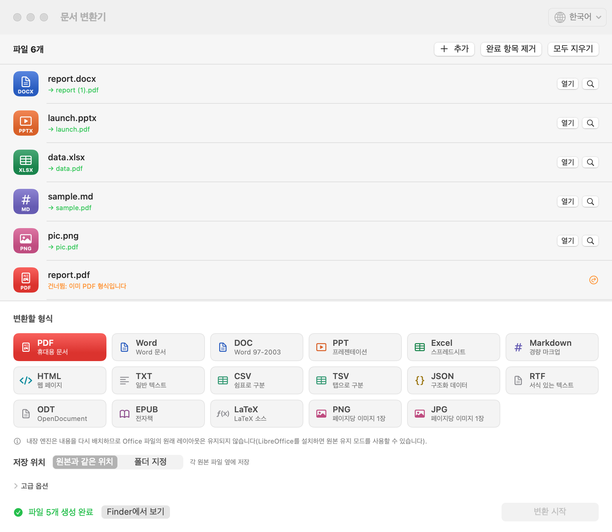

# 문서 변환기 for macOS

[English](README.md) · [简体中文](README.zh-CN.md) · [繁體中文](README.zh-TW.md) · [日本語](README.ja.md) · **한국어** · [Français](README.fr.md) · [Deutsch](README.de.md) · [Español](README.es.md)

PDF, Word, PowerPoint, Excel, Markdown과 일반적인 텍스트 형식을 서로 변환합니다. Swift로 만든 네이티브 앱으로, Office, LibreOffice, Python, 인터넷 연결이 필요하지 않습니다.

- **앱**: 파일을 끌어다 놓고(여러 개 또는 폴더 전체도 가능) → 변환할 형식을 고른 뒤 → 변환 시작
- **명령줄**: `docconv`, 일괄 처리와 스크립트용
- **8개 인터페이스 언어**: 简体中文, 繁體中文, English, 日本語, 한국어, Français, Deutsch, Español. 기본적으로 시스템 언어를 따르며, 도구 막대의 🌐 메뉴에서 언제든 바꿀 수 있습니다
- Apple 실리콘과 Intel Mac 지원, macOS 13 이상



## 지원 형식

| 형식 | 읽기 | 쓰기 | 설명 |
| --- | :-: | :-: | --- |
| PDF | ✓ | ✓ | 읽기: 텍스트, 제목, 목록, 간단한 표, 코드를 추출합니다. 스캔 페이지는 시스템 텍스트 인식(OCR)으로 처리하며, ‘페이지 전체를 이미지로’도 선택할 수 있습니다. 쓰기: 자동 페이지 나누기, 페이지 번호, 표, 이미지, 링크 |
| Word .docx | ✓ | ✓ | 제목 스타일, 다단계 목록, 표, 이미지, 링크, 굵게/기울임/취소선, 페이지 나누기 |
| Word 97 .doc | ✓ | ✓ | macOS 텍스트 시스템을 통해 처리 |
| PowerPoint .pptx | ✓ | ✓ | 읽기: 각 슬라이드의 제목, 본문 수준, 표, 이미지, 선택적으로 발표자 노트. 쓰기: 제목을 기준으로 슬라이드를 나누고, 넘치는 내용은 새 슬라이드로 이어집니다 |
| Excel .xlsx | ✓ | ✓ | 여러 시트, 날짜, 백분율, 숫자. 내보낼 때 머리글 행을 고정하고 필터를 켭니다 |
| Markdown | ✓ | ✓ | CommonMark 주요 문법 + GFM 표, 취소선, 작업 목록. 이미지는 `_assets` 폴더에 저장(포함도 가능) |
| HTML | ✓ | ✓ | 스타일이 적용된 단일 페이지로 쓰며 이미지는 포함 |
| TXT | ✓ | ✓ | UTF-8 / UTF-16 / GBK / GB18030 / Big5 / Shift-JIS 자동 인식 |
| CSV / TSV | ✓ | ✓ | 구분자 자동 인식. BOM을 붙여 써서 Excel에서도 글자가 깨지지 않습니다. 표가 여러 개면 파일도 여러 개 |
| JSON | ✓ | ✓ | 표 ↔ 객체 배열. 그 밖의 문서는 구조화된 JSON으로 |
| RTF / ODT | ✓ | ✓ | |
| EPUB | ✓ | ✓ | 장별로 나누고 목차 포함 |
| LaTeX | | ✓ | ctex 템플릿, xelatex로 컴파일 |
| PNG / JPG | ✓ | ✓ | PDF는 페이지별로 래스터화하고, 다른 문서는 먼저 레이아웃한 뒤 이미지로 만듭니다. 이미지는 PDF, Word, PowerPoint로 변환 가능 |

## 작동 방식

모든 형식은 먼저 하나의 공통 **중간 구조**(제목, 단락, 목록, 표, 코드, 인용, 이미지, 페이지 나누기)로 읽은 다음, 그 구조에서 목표 형식으로 씁니다. 따라서 N개의 입력 형식과 M개의 출력 형식에 N+M개의 읽기/쓰기 모듈만 있으면 되고, 어떤 조합이든 변환할 수 있습니다.

### 충실도에 대해

- **PDF → Word / PowerPoint / Excel**은 텍스트와 구조를 추출할 뿐, 페이지 레이아웃을 재구성하지는 않습니다. 다단 레이아웃, 복잡한 표, 떠 있는 그래픽은 완전히 재현되지 않습니다. 모양을 유지하려면 ‘고급 옵션’에서 ‘페이지 전체를 이미지로’를 선택하세요(각 페이지가 이미지로 들어가며 텍스트는 편집할 수 없습니다).
- **Office → PDF**는 내장 엔진이 내용을 다시 배치하므로 원래 글꼴, 레이아웃, 애니메이션은 유지되지 않습니다. [LibreOffice](https://www.libreoffice.org)가 설치되어 있으면 고급 옵션에서 원본 유지 모드를 켜고 LibreOffice로 변환할 수 있습니다.
- **Excel / CSV로 내보내기**는 표만 남깁니다. 표가 없는 문서는 텍스트를 한 줄씩 기록합니다.
- 변환할 때 문서에 추가되는 문구(‘슬라이드 3’, ‘발표자 노트’, ‘(계속)’, ‘[이미지]’ 등)는 현재 인터페이스 언어를 따릅니다.
- 생성되는 PDF는 Hiragino Sans GB 글꼴을 사용합니다. PingFang을 쓰면 텍스트를 복사할 때 일부 한자가 ‘⼀’, ‘⻓’ 같은 강희 부수 문자로 바뀌기 때문입니다. 다른 프로그램이 만든 PDF에 이런 문자가 있어도 읽을 때 자동으로 고칩니다.

## 사용법

### 앱

`DocConverter.app`을 엽니다.

이 앱은 로컬에서만 서명했으며 Apple의 공증을 받지 않았습니다. 다운로드한 경우 처음 열 때 ‘개발자를 확인할 수 없습니다’라는 메시지가 나타날 수 있습니다. 다음 중 하나로 열 수 있습니다.

- ‘시스템 설정 → 개인정보 보호 및 보안’을 열고 아래쪽의 ‘그래도 열기’를 클릭
- 또는 터미널에서 `xattr -dr com.apple.quarantine DocConverter.app` 실행

데스크탑, 문서, 다운로드 폴더의 파일을 변환할 때 macOS가 해당 폴더 접근을 허용할지 묻습니다. ‘허용’을 선택하세요.

- 파일이나 폴더를 창에 끌어다 놓거나 ⌘O로 추가
- 변환할 형식을 선택(현재 파일로 변환할 수 없는 형식은 흐리게 표시)
- 저장 위치는 ‘원본과 같은 위치’ 또는 ‘폴더 지정’. 같은 이름의 파일은 덮어쓰지 않고 (1), (2)를 붙여 저장합니다
- ⌘↩로 변환 시작. 끝나면 바로 열거나 Finder에서 볼 수 있습니다
- Finder에서 파일에 ‘다음으로 열기 → 문서 변환기’를 사용할 수도 있습니다
- 인터페이스 언어는 도구 막대의 🌐 메뉴에서 바꿉니다. 시스템 메뉴(편집, 윈도우 등)는 앱을 다시 열면 바뀝니다. ‘시스템 설정 → 일반 → 언어 및 지역 → 앱’에서 앱별로 설정할 수도 있습니다

### 명령줄

```bash
# 명령줄 도구는 앱 안에 들어 있으며 PATH에 링크할 수 있습니다
ln -s "$PWD/DocConverter.app/Contents/MacOS/docconv" /usr/local/bin/docconv

docconv -t docx 보고서.pdf                  # PDF → Word
docconv -t pdf -o ~/Desktop/out *.md       # Markdown → PDF 일괄 변환
docconv -t pptx --split 1 발표.md          # 제목 1마다 슬라이드 나누기
docconv -t md --notes 발표회.pptx          # 발표자 노트도 함께 내보내기
docconv -t png --dpi 300 계약서.pdf         # PDF의 모든 페이지를 PNG로
docconv --lang ko --formats                # 메시지를 한국어로 표시
docconv --help                             # 모든 옵션
```

명령줄 도구의 언어는 `--lang`, `LC_ALL` / `LC_MESSAGES` / `LANG`, 시스템 언어 순서로 정해집니다.

## 소스에서 빌드하기

Xcode 전체가 아니라 Xcode 명령줄 도구(`xcode-select --install`)만 있으면 됩니다.

```bash
scripts/build_app.sh            # 유니버설 dist/DocConverter.app 및 dist/DocConverter.zip
NATIVE=1 scripts/build_app.sh   # 이 Mac의 아키텍처만(더 빠름)
scripts/selftest.sh             # 빠른 자체 테스트: 샘플을 모든 형식으로 변환했다 되돌리고 ZIP/XML 검사
scripts/fulltest.sh             # 전체 테스트: 변환 매트릭스, 모든 옵션, 잘못된 입력, 성능
swift run docconv --help        # 명령줄 도구 바로 실행
```

`PYTHON=/path/to/python scripts/fulltest.sh`를 쓰면 python-docx, openpyxl, python-pptx로 모든 Word, Excel, PowerPoint 출력을 열어 확인합니다(해당 Python에 설치되어 있는 경우).

## 프로젝트 구조

```
Sources/
  DocCore/           플랫폼 독립 코어: 중간 구조, ZIP, XML, 인코딩 인식,
                     md/html/txt/csv/json/docx/pptx/xlsx/epub/tex 읽기와 쓰기
    Localization/    인터페이스 문구, 언어마다 파일 하나
  DocCoreMac/        macOS 전용: PDF(PDFKit + TextKit), RTF/DOC/ODT, 이미지 출력,
                     Vision OCR, LibreOffice 연동
  docconv/           명령줄 도구
  DocConverterApp/   SwiftUI 앱
scripts/             패키징, 아이콘, 테스트
Tests/fixtures/      테스트 문서
```

### 언어 추가하기

1. `Sources/DocCore/Localization/Localization.swift`의 `AppLanguage`에 case를 추가합니다.
2. `Strings+en.swift`를 `Strings+xx.swift`로 복사해 번역합니다. 모든 문구가 `LocalizedStrings` 프로토콜의 필수 멤버이므로 빠뜨린 항목은 컴파일러가 알려 줍니다.
3. `scripts/build_app.sh`의 `LANGS`에 언어 코드를 추가합니다.

중국어와 영어 문구는 이 프로젝트를 위해 작성되었습니다. 다른 언어의 번역은 아직 원어민 검토를 받지 않았으니 수정 제안을 환영합니다.

### Windows / Linux 버전

`DocCore`는 Foundation과 zlib에만 의존하므로 Windows와 Linux의 Swift 툴체인으로 바로 빌드할 수 있습니다(Linux에서는 zlib용 system library 타깃이 필요). 바꿔야 하는 것은 `DocCoreMac` 계층뿐입니다: PDF 읽기와 쓰기, RTF/DOC/ODT, OCR, 이미지 인코딩. 앱 화면은 새로 작성하거나 크로스 플랫폼 프레임워크로 옮겨야 합니다.
