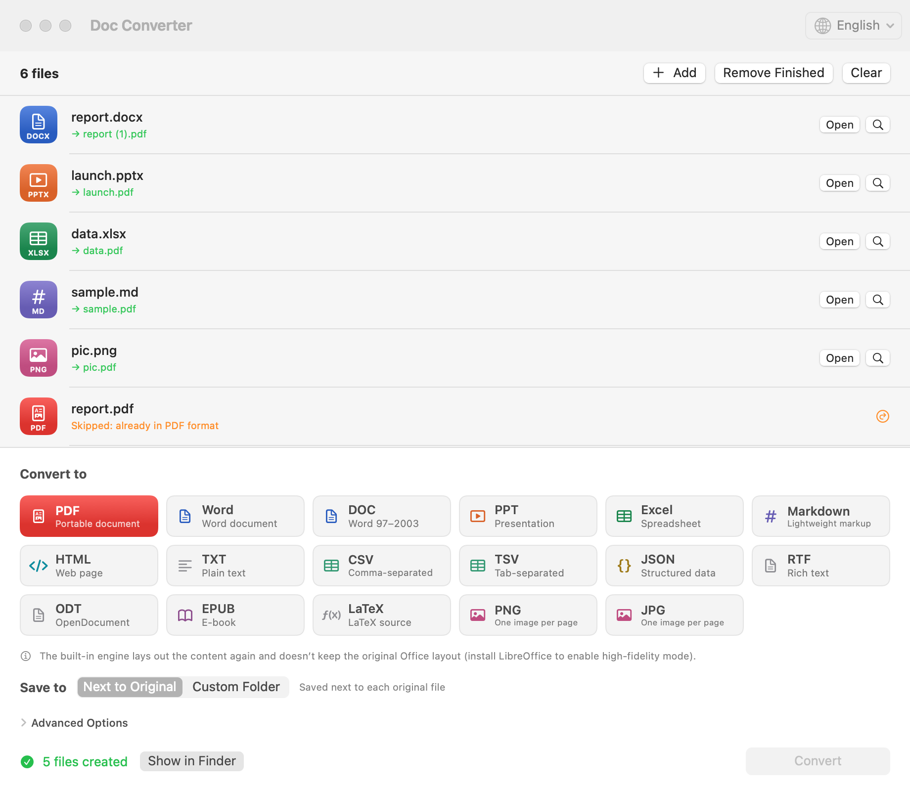

# Doc Converter for macOS

**English** · [简体中文](README.zh-CN.md) · [繁體中文](README.zh-TW.md) · [日本語](README.ja.md) · [한국어](README.ko.md) · [Français](README.fr.md) · [Deutsch](README.de.md) · [Español](README.es.md)

Convert between PDF, Word, PowerPoint, Excel, Markdown and common text formats. Written natively in Swift, with no dependency on Office, LibreOffice, Python or the internet.

- **App**: drop in files (several at once, or whole folders) → pick a target format → Convert
- **Command line**: `docconv`, for batch jobs and scripts
- **8 interface languages**: 简体中文, 繁體中文, English, 日本語, 한국어, Français, Deutsch, Español. Follows the system language by default; switch any time from the 🌐 menu in the toolbar
- Runs on Apple silicon and Intel Macs, macOS 13 or later



## Supported formats

| Format | Read | Write | Notes |
| --- | :-: | :-: | --- |
| PDF | ✓ | ✓ | Reading: extracts text, headings, lists, simple tables and code; scanned pages go through macOS text recognition (OCR); or choose “Whole pages as images”. Writing: automatic pagination, page numbers, tables, images and links |
| Word .docx | ✓ | ✓ | Heading styles, multi-level lists, tables, images, links, bold/italic/strikethrough, page breaks |
| Word 97 .doc | ✓ | ✓ | Through the macOS text system |
| PowerPoint .pptx | ✓ | ✓ | Reading: each slide’s title, body levels, tables, images, optional speaker notes. Writing: slides split at headings, overflowing content continues on new slides |
| Excel .xlsx | ✓ | ✓ | Multiple sheets, dates, percentages, numbers; header row frozen and filtered on export |
| Markdown | ✓ | ✓ | Common CommonMark syntax plus GFM tables, strikethrough and task lists; images saved to an `_assets` folder (or embedded) |
| HTML | ✓ | ✓ | Written as a single styled page with embedded images |
| TXT | ✓ | ✓ | Detects UTF-8 / UTF-16 / GBK / GB18030 / Big5 / Shift-JIS |
| CSV / TSV | ✓ | ✓ | Detects the delimiter; written with a BOM so Excel opens non-Latin text correctly; several tables produce several files |
| JSON | ✓ | ✓ | Tables ↔ arrays of objects; other documents become structured JSON |
| RTF / ODT | ✓ | ✓ | |
| EPUB | ✓ | ✓ | Split into chapters, with a table of contents |
| LaTeX | | ✓ | ctex template, compile with xelatex |
| PNG / JPG | ✓ | ✓ | PDFs are rasterized page by page; other documents are laid out first; images can become PDF, Word or PowerPoint |

## How it works

Every format is first read into one shared **intermediate structure** (headings, paragraphs, lists, tables, code, quotes, images, page breaks) and then written out from it. N input formats and M output formats therefore need only N + M readers and writers, and any pair can be converted.

### About fidelity

- **PDF → Word / PowerPoint / Excel** extracts text and structure; it does not rebuild the page layout. Multi-column layouts, complex tables and floating graphics cannot be fully reproduced. To keep the look, choose “Whole pages as images” in Advanced Options (each page is placed as an image; the text is not editable).
- **Office → PDF** is laid out again by the built-in engine and does not keep the original fonts, layout or animations. If [LibreOffice](https://www.libreoffice.org) is installed you can turn on high-fidelity mode in Advanced Options and let LibreOffice do the conversion.
- **Exporting to Excel / CSV** keeps only the tables; documents without tables are written line by line.
- Labels the converter adds to documents (such as “Slide 3”, “Speaker Notes”, “(cont.)” or “[Image]”) use the current interface language.
- Generated PDFs use the Hiragino Sans GB font. With PingFang, some Chinese characters turn into Kangxi radicals (such as “⼀” or “⻓”) when text is copied; PDFs from other software that contain such characters are fixed automatically when read.

## Using it

### App

Open `DocConverter.app`.

The app is only signed locally and is not notarized by Apple. If you downloaded it, macOS may say the developer cannot be verified the first time you open it. Either:

- open **System Settings → Privacy & Security** and click **Open Anyway** near the bottom, or
- run `xattr -dr com.apple.quarantine DocConverter.app` in Terminal

When you convert files in Desktop, Documents or Downloads, macOS asks whether the app may access that folder. Choose **Allow**.

- Drop files or folders onto the window, or press ⌘O
- Pick a target format (formats the current files can’t be converted to are greyed out)
- Choose where to save: next to the original, or a folder of your choice. Existing files are never overwritten; a (1), (2)… suffix is added instead
- Press ⌘↩ to convert; open the results or show them in Finder when done
- You can also use **Open With → Doc Converter** on files in Finder
- Change the interface language from the 🌐 menu in the toolbar. System menus (Edit, Window…) switch after the app is reopened. The per-app language setting in System Settings → General → Language & Region also works

### Command line

```bash
# The command-line tool ships inside the app; you can link it into your PATH
ln -s "$PWD/DocConverter.app/Contents/MacOS/docconv" /usr/local/bin/docconv

docconv -t docx report.pdf                 # PDF → Word
docconv -t pdf -o ~/Desktop/out *.md       # batch Markdown → PDF
docconv -t pptx --split 1 talk.md          # one slide per level-1 heading
docconv -t md --notes keynote.pptx         # include speaker notes
docconv -t png --dpi 300 contract.pdf      # every PDF page as a PNG
docconv --lang ja --formats                # messages in Japanese
docconv --help                             # all options
```

The command-line tool picks its language from `--lang`, then `LC_ALL` / `LC_MESSAGES` / `LANG`, then the system language.

## Building from source

Only the Xcode Command Line Tools are needed (`xcode-select --install`), not the full Xcode.

```bash
scripts/build_app.sh            # universal dist/DocConverter.app and dist/DocConverter.zip
NATIVE=1 scripts/build_app.sh   # this Mac’s architecture only (faster)
scripts/selftest.sh             # quick self-test: sample to every format and back, ZIP/XML checks
scripts/fulltest.sh             # full test: conversion matrix, every option, broken inputs, performance
swift run docconv --help        # run the command-line tool directly
```

`PYTHON=/path/to/python scripts/fulltest.sh` additionally opens every Word, Excel and PowerPoint output with python-docx, openpyxl and python-pptx, if that Python has them installed.

## Project layout

```
Sources/
  DocCore/           platform-independent core: intermediate structure, ZIP, XML, encoding detection,
                     md/html/txt/csv/json/docx/pptx/xlsx/epub/tex readers and writers
    Localization/    interface text, one file per language
  DocCoreMac/        macOS-specific: PDF (PDFKit + TextKit), RTF/DOC/ODT, image output,
                     Vision OCR, LibreOffice bridge
  docconv/           command-line tool
  DocConverterApp/   SwiftUI app
scripts/             packaging, icon, tests
Tests/fixtures/      test documents
```

### Adding a language

1. Add a case to `AppLanguage` in `Sources/DocCore/Localization/Localization.swift`.
2. Copy `Strings+en.swift` to `Strings+xx.swift` and translate it. Every message is a required member of the `LocalizedStrings` protocol, so the compiler lists anything you missed.
3. Add the language code to `LANGS` in `scripts/build_app.sh`.

The Chinese and English text was written for this project; the other translations have not yet been reviewed by native speakers, and corrections are welcome.

### Windows / Linux

`DocCore` depends only on Foundation and zlib and builds with the Swift toolchain on Windows and Linux (Linux needs a system-library target for zlib). Only the `DocCoreMac` layer has to be replaced: PDF reading and writing, RTF/DOC/ODT, OCR and image encoding. The app’s interface would need to be rewritten or moved to a cross-platform framework.
