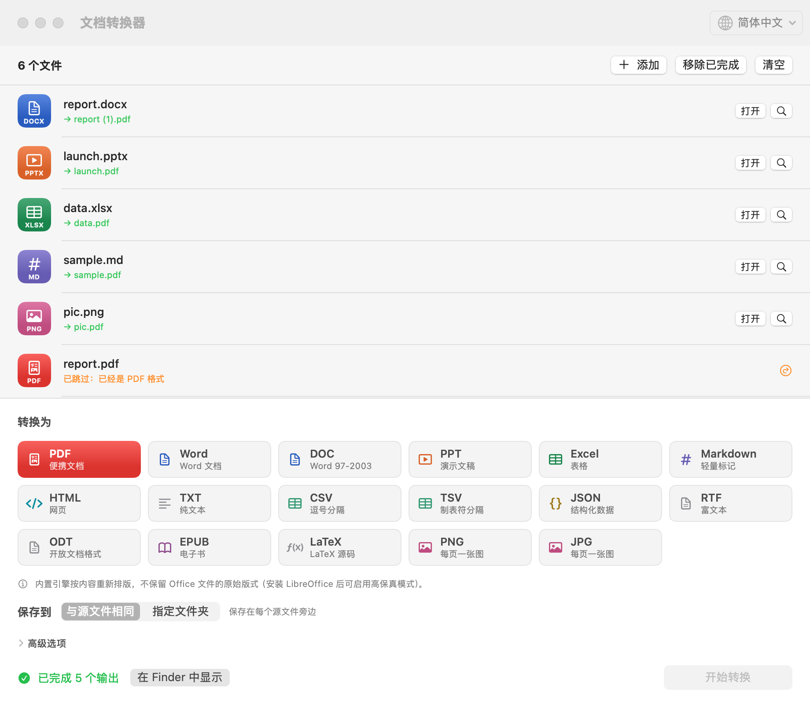

# 文档转换器 · macOS 版

[English](README.md) · **简体中文** · [繁體中文](README.zh-TW.md) · [日本語](README.ja.md) · [한국어](README.ko.md) · [Français](README.fr.md) · [Deutsch](README.de.md) · [Español](README.es.md)

在 PDF、Word、PowerPoint、Excel、Markdown 以及常见文本格式之间互相转换。原生 Swift 编写，不依赖 Office、LibreOffice、Python 或网络，下载即用。

- **图形界面**：拖入文件（可多个，也可拖入文件夹）→ 选目标格式 → 开始转换
- **命令行**：`docconv`，适合批量处理和脚本
- **8 种界面语言**：简体中文、繁體中文、English、日本語、한국어、Français、Deutsch、Español。默认跟随系统，可随时在工具栏的 🌐 菜单中切换
- 支持 Apple 芯片和 Intel Mac，最低 macOS 13



## 支持的格式

| 格式 | 读取 | 写出 | 说明 |
| --- | :-: | :-: | --- |
| PDF | ✓ | ✓ | 读取：提取文字、标题、列表、简单表格、代码；扫描页用系统 OCR；也可以选择「整页转图片」。写出：自动分页，带页码、表格、图片和超链接 |
| Word .docx | ✓ | ✓ | 标题样式、多级列表、表格、图片、超链接、粗体/斜体/删除线、分页 |
| Word 97 .doc | ✓ | ✓ | 经由系统文本引擎 |
| PowerPoint .pptx | ✓ | ✓ | 读取：每页的标题、正文层级、表格、图片，可选演讲者备注。写出：按标题拆分幻灯片，过长内容自动分页 |
| Excel .xlsx | ✓ | ✓ | 多工作表、日期、百分比、数字；写出时冻结表头并开启筛选 |
| Markdown | ✓ | ✓ | CommonMark 常用语法 + GFM 表格、删除线、任务列表；图片另存到 `_assets` 目录（也可内嵌） |
| HTML | ✓ | ✓ | 写出为带样式的单文件网页，图片内嵌 |
| TXT | ✓ | ✓ | 自动识别 UTF-8 / UTF-16 / GBK / GB18030 / Big5 / Shift-JIS 编码 |
| CSV / TSV | ✓ | ✓ | 自动识别分隔符；写出带 BOM，Excel 打开中文不乱码；多张表输出多个文件 |
| JSON | ✓ | ✓ | 表格 ↔ 对象数组；其他文档输出为结构化 JSON |
| RTF / ODT | ✓ | ✓ | |
| EPUB | ✓ | ✓ | 按章节拆分，带目录 |
| LaTeX | | ✓ | ctex 中文模板，用 xelatex 编译 |
| PNG / JPG | ✓ | ✓ | PDF 按页栅格化；其他文档先排版再出图；图片可以转成 PDF、Word、PPT |

## 工作原理

所有格式先读成统一的**中间结构**（标题、段落、列表、表格、代码、引用、图片、分页），再从中间结构写成目标格式。这样 N 种输入和 M 种输出只需 N+M 个读写模块，任意两种格式都能互转。

### 关于保真度

- **PDF → Word / PPT / Excel** 是「提取文字与结构」，不是还原版式：多栏排版、复杂表格、浮动图形无法完全还原。需要外观一致时，在「高级选项」里选「整页转图片」（每页作为图片放入文档，内容不可编辑）。
- **Office → PDF** 由内置引擎按内容重新排版，不保留原 Office 的字体、版式和动画。如果装了 [LibreOffice](https://www.libreoffice.org)，可以在高级选项里开启高保真模式，由 LibreOffice 完成转换。
- **导出为 Excel / CSV** 只保留文档里的表格；没有表格的文档会把文字逐行写入。
- 转换时自动加入文档的文字（如「幻灯片 3」「演讲者备注」「（续）」「[图片]」）使用当前界面语言。
- 生成的 PDF 使用冬青黑体，避免 macOS 苹方字体导致复制文字时部分汉字变成「⼀」「⻓」这类康熙部首字符；读取其他软件生成的 PDF 时，也会把这类字符自动还原。

## 使用

### 图形界面

打开 `DocConverter.app`。

程序只做了本地签名，没有经过 Apple 公证。如果是下载得到的，第一次打开时 macOS 可能提示「无法验证开发者」，可以用下面两种办法之一：

- 打开「系统设置 → 隐私与安全性」，在页面下方点「仍要打开」
- 或在终端执行 `xattr -dr com.apple.quarantine DocConverter.app`

转换桌面、文稿、下载文件夹里的文件时，macOS 会询问是否允许访问该文件夹，选「允许」即可。

- 拖入文件或文件夹，或按 ⌘O 添加
- 选择目标格式（当前文件不支持的格式会变灰）
- 输出位置可以选「与源文件相同」或「指定文件夹」；同名文件不会被覆盖，而是自动加上 (1)、(2) 后缀
- 按 ⌘↩ 开始转换，完成后可直接打开或在 Finder 中显示
- 也可以在 Finder 里对文件用「打开方式 → 文档转换器」
- 在工具栏的 🌐 菜单中切换界面语言；系统提供的菜单（编辑、窗口等）在重新打开 App 后切换。也可以在「系统设置 → 通用 → 语言与地区 → App」中为本 App 单独设置语言

### 命令行

```bash
# App 里自带命令行工具，可以建个软链接
ln -s "$PWD/DocConverter.app/Contents/MacOS/docconv" /usr/local/bin/docconv

docconv -t docx 报告.pdf                    # PDF → Word
docconv -t pdf -o ~/Desktop/out *.md       # 批量 Markdown → PDF
docconv -t pptx --split 1 讲稿.md          # 按一级标题拆分幻灯片
docconv -t md --notes 发布会.pptx          # 连同演讲者备注一起导出
docconv -t png --dpi 300 合同.pdf           # PDF 每页导出为 PNG
docconv --lang ja --formats                # 用日文显示提示
docconv --help                             # 全部选项
```

命令行的语言依次取 `--lang`、`LC_ALL` / `LC_MESSAGES` / `LANG`、系统语言。

## 从源码构建

只需要 Xcode 命令行工具（`xcode-select --install`），不需要完整的 Xcode。

```bash
scripts/build_app.sh            # 构建通用版 dist/DocConverter.app 和 dist/DocConverter.zip
NATIVE=1 scripts/build_app.sh   # 只构建本机架构（更快）
scripts/selftest.sh             # 快速自测：样例转成所有格式再转回，并检查 ZIP/XML 合法性
scripts/fulltest.sh             # 全面测试：转换矩阵、每个选项、异常输入、性能
swift run docconv --help        # 直接运行命令行版
```

`PYTHON=/path/to/python scripts/fulltest.sh` 会另外用 python-docx、openpyxl、python-pptx 打开所有 Word、Excel、PPT 输出（需要该 Python 已安装这三个库）。

## 项目结构

```
Sources/
  DocCore/           平台无关核心：中间结构、ZIP、XML、编码识别，
                     以及 md/html/txt/csv/json/docx/pptx/xlsx/epub/tex 的读写
    Localization/    界面文字，每种语言一个文件
  DocCoreMac/        macOS 专用：PDF 读写（PDFKit + TextKit）、RTF/DOC/ODT、
                     图片输出、Vision OCR、LibreOffice 桥接
  docconv/           命令行工具
  DocConverterApp/   SwiftUI 图形界面
scripts/             打包、图标生成、测试脚本
Tests/fixtures/      测试文档
```

### 增加一种语言

1. 在 `Sources/DocCore/Localization/Localization.swift` 的 `AppLanguage` 里加一个 case。
2. 把 `Strings+en.swift` 复制为 `Strings+xx.swift` 并翻译。每条文字都是 `LocalizedStrings` 协议的必需成员，漏翻的地方编译器会逐条列出。
3. 在 `scripts/build_app.sh` 的 `LANGS` 里加上语言代码。

中文和英文为本项目原创；其他语言的翻译还没有经过母语者审校，欢迎指正。

### 后续做 Windows / Linux 版

`DocCore` 只依赖 Foundation 和 zlib，可以直接在 Windows / Linux 的 Swift 工具链上编译（Linux 上需要为 zlib 加一个 system library target）。需要替换的只有 `DocCoreMac` 这一层：PDF 读写、RTF/DOC/ODT、OCR、图片编码。图形界面需要另写，或改用跨平台框架。
