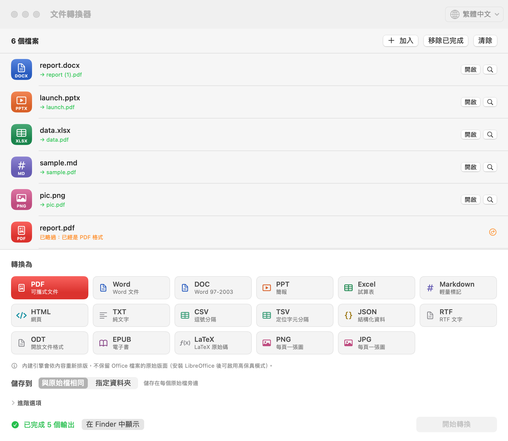

# 文件轉換器 · macOS 版

[English](README.md) · [简体中文](README.zh-CN.md) · **繁體中文** · [日本語](README.ja.md) · [한국어](README.ko.md) · [Français](README.fr.md) · [Deutsch](README.de.md) · [Español](README.es.md)

在 PDF、Word、PowerPoint、Excel、Markdown 以及常見文字格式之間互相轉換。以原生 Swift 撰寫，不需要 Office、LibreOffice、Python 或網路，下載即可使用。

- **圖形介面**：拖入檔案（可多個，也可拖入資料夾）→ 選擇目標格式 → 開始轉換
- **命令列**：`docconv`，適合批次處理和指令碼
- **8 種介面語言**：简体中文、繁體中文、English、日本語、한국어、Français、Deutsch、Español。預設跟隨系統，可隨時在工具列的 🌐 選單中切換
- 支援 Apple 晶片和 Intel Mac，最低 macOS 13



## 支援的格式

| 格式 | 讀取 | 輸出 | 說明 |
| --- | :-: | :-: | --- |
| PDF | ✓ | ✓ | 讀取：擷取文字、標題、清單、簡單表格、程式碼；掃描頁使用系統 OCR；也可以選擇「整頁轉圖片」。輸出：自動分頁，含頁碼、表格、圖片和超連結 |
| Word .docx | ✓ | ✓ | 標題樣式、多層清單、表格、圖片、超連結、粗體／斜體／刪除線、分頁 |
| Word 97 .doc | ✓ | ✓ | 透過系統文字引擎 |
| PowerPoint .pptx | ✓ | ✓ | 讀取：每張投影片的標題、內文層級、表格、圖片，可選擇包含備忘稿。輸出：依標題分割投影片，過長內容自動延續到新投影片 |
| Excel .xlsx | ✓ | ✓ | 多個工作表、日期、百分比、數字；輸出時凍結標題列並開啟篩選 |
| Markdown | ✓ | ✓ | CommonMark 常用語法 + GFM 表格、刪除線、工作清單；圖片另存到 `_assets` 資料夾（也可內嵌） |
| HTML | ✓ | ✓ | 輸出為含樣式的單一網頁，圖片內嵌 |
| TXT | ✓ | ✓ | 自動辨識 UTF-8 / UTF-16 / GBK / GB18030 / Big5 / Shift-JIS 編碼 |
| CSV / TSV | ✓ | ✓ | 自動辨識分隔符號；輸出含 BOM，Excel 開啟中文不會亂碼；多個表格輸出為多個檔案 |
| JSON | ✓ | ✓ | 表格 ↔ 物件陣列；其他文件輸出為結構化 JSON |
| RTF / ODT | ✓ | ✓ | |
| EPUB | ✓ | ✓ | 依章節分割，含目錄 |
| LaTeX | | ✓ | ctex 中文範本，以 xelatex 編譯 |
| PNG / JPG | ✓ | ✓ | PDF 逐頁點陣化；其他文件先排版再輸出圖片；圖片可以轉成 PDF、Word、簡報 |

## 運作方式

所有格式都先讀成統一的**中間結構**（標題、段落、清單、表格、程式碼、引言、圖片、分頁），再從中間結構寫成目標格式。因此 N 種輸入和 M 種輸出只需要 N+M 個讀寫模組，任意兩種格式都能互轉。

### 關於保真度

- **PDF → Word／簡報／Excel** 是「擷取文字與結構」，不是重建版面：多欄排版、複雜表格、浮動圖形無法完全還原。需要外觀一致時，請在「進階選項」中選擇「整頁轉圖片」（每頁以圖片放入文件，內容無法編輯）。
- **Office → PDF** 由內建引擎依內容重新排版，不保留原始 Office 的字型、版面和動畫。若已安裝 [LibreOffice](https://www.libreoffice.org)，可在進階選項中開啟高保真模式，由 LibreOffice 完成轉換。
- **輸出為 Excel／CSV** 只保留文件中的表格；沒有表格的文件會把文字逐行寫入。
- 轉換時自動加入文件的文字（例如「投影片 3」「備忘稿」「（續）」「[圖片]」）使用目前的介面語言。
- 產生的 PDF 使用冬青黑體，避免 macOS 蘋方字型在複製文字時讓部分漢字變成「⼀」「⻓」等康熙部首字元；讀取其他軟體產生的 PDF 時，也會自動還原這類字元。

## 使用方式

### 圖形介面

開啟 `DocConverter.app`。

本程式只經過本機簽署，沒有經過 Apple 公證。如果是下載取得，第一次開啟時 macOS 可能顯示「無法驗證開發者」，可以使用下列任一方法：

- 開啟「系統設定 → 隱私權與安全性」，在頁面下方按「強制打開」
- 或在終端機執行 `xattr -dr com.apple.quarantine DocConverter.app`

轉換桌面、文件、下載項目資料夾中的檔案時，macOS 會詢問是否允許存取該資料夾，請選擇「允許」。

- 拖入檔案或資料夾，或按 ⌘O 加入
- 選擇目標格式（目前的檔案無法轉換的格式會變灰）
- 儲存位置可選「與原始檔相同」或「指定資料夾」；同名檔案不會被覆蓋，而是自動加上 (1)、(2) 後綴
- 按 ⌘↩ 開始轉換，完成後可直接開啟或在 Finder 中顯示
- 也可以在 Finder 中對檔案使用「打開檔案的應用程式 → 文件轉換器」
- 在工具列的 🌐 選單中切換介面語言；系統提供的選單（編輯、視窗等）會在重新開啟 App 後切換。也可以在「系統設定 → 一般 → 語言與地區 → App」中為本 App 單獨設定語言

### 命令列

```bash
# App 內附命令列工具，可以建立符號連結
ln -s "$PWD/DocConverter.app/Contents/MacOS/docconv" /usr/local/bin/docconv

docconv -t docx 報告.pdf                    # PDF → Word
docconv -t pdf -o ~/Desktop/out *.md       # 批次 Markdown → PDF
docconv -t pptx --split 1 講稿.md          # 依一級標題分割投影片
docconv -t md --notes 發表會.pptx          # 連同備忘稿一起匯出
docconv -t png --dpi 300 合約.pdf           # PDF 每頁輸出為 PNG
docconv --lang ja --formats                # 以日文顯示訊息
docconv --help                             # 所有選項
```

命令列的語言依序取自 `--lang`、`LC_ALL` / `LC_MESSAGES` / `LANG`、系統語言。

## 從原始碼建置

只需要 Xcode 命令列工具（`xcode-select --install`），不需要完整的 Xcode。

```bash
scripts/build_app.sh            # 建置通用版 dist/DocConverter.app 和 dist/DocConverter.zip
NATIVE=1 scripts/build_app.sh   # 只建置本機架構（較快）
scripts/selftest.sh             # 快速自我測試：樣本轉成所有格式再轉回，並檢查 ZIP/XML
scripts/fulltest.sh             # 完整測試：轉換矩陣、每個選項、異常輸入、效能
swift run docconv --help        # 直接執行命令列版
```

`PYTHON=/path/to/python scripts/fulltest.sh` 會另外用 python-docx、openpyxl、python-pptx 開啟所有 Word、Excel、簡報輸出（該 Python 需已安裝這三個套件）。

## 專案結構

```
Sources/
  DocCore/           與平台無關的核心：中間結構、ZIP、XML、編碼辨識，
                     以及 md/html/txt/csv/json/docx/pptx/xlsx/epub/tex 的讀寫
    Localization/    介面文字，每種語言一個檔案
  DocCoreMac/        macOS 專用：PDF 讀寫（PDFKit + TextKit）、RTF/DOC/ODT、
                     圖片輸出、Vision OCR、LibreOffice 橋接
  docconv/           命令列工具
  DocConverterApp/   SwiftUI 圖形介面
scripts/             打包、圖示產生、測試指令碼
Tests/fixtures/      測試文件
```

### 新增一種語言

1. 在 `Sources/DocCore/Localization/Localization.swift` 的 `AppLanguage` 中加入一個 case。
2. 把 `Strings+en.swift` 複製為 `Strings+xx.swift` 並翻譯。每條文字都是 `LocalizedStrings` 協定的必要成員，漏譯的地方編譯器會逐條列出。
3. 在 `scripts/build_app.sh` 的 `LANGS` 中加入語言代碼。

中文和英文為本專案原創；其他語言的翻譯尚未經過母語人士校對，歡迎指正。

### 日後製作 Windows / Linux 版

`DocCore` 只依賴 Foundation 和 zlib，可直接以 Windows / Linux 的 Swift 工具鏈編譯（Linux 上需要為 zlib 加一個 system library target）。需要替換的只有 `DocCoreMac` 這一層：PDF 讀寫、RTF/DOC/ODT、OCR、圖片編碼。圖形介面需要另外撰寫，或改用跨平台框架。
